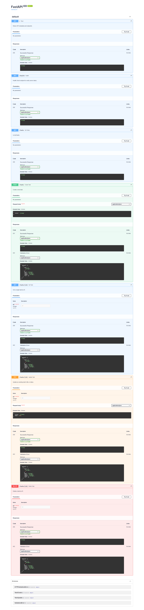

# Task CRUD API

A lightweight RESTful CRUD API built with Python and FastAPI to manage tasks. All data lives in-memory with zero database dependencies, adhering to REST standards, clear HTTP status codes, and input validation.

---

## Quickstart

### 1. Installation & Running
Run the server with one command:
```bash
pip install fastapi uvicorn
uvicorn main:app --reload
```
The server starts locally at `http://localhost:8000`.

---

## API Endpoints

| Method | Endpoint | Description | Request Body | Status Codes |
| :--- | :--- | :--- | :--- | :--- |
| `GET` | `/` | API metadata and endpoint discovery | None | `200 OK` |
| `GET` | `/health` | Server health check | None | `200 OK` |
| `GET` | `/tasks` | List all tasks | None | `200 OK` |
| `GET` | `/tasks/{id}` | Retrieve a single task by ID | None | `200 OK`, `404 Not Found` |
| `POST` | `/tasks` | Create a new task | `{"title": "string"}` | `201 Created`, `400 Bad Request` |
| `PUT` | `/tasks/{id}` | Update task title and/or done status | `{"title": "...", "done": ...}` | `200 OK`, `400 Bad Request`, `404 Not Found` |
| `DELETE` | `/tasks/{id}` | Delete a task by ID | None | `204 No Content`, `404 Not Found` |

---

## Interactive Documentation (Swagger UI)

FastAPI automatically generates an interactive Swagger UI documentation page at:
👉 **[http://localhost:8000/docs](http://localhost:8000/docs)**



---

## Sample `curl -i` Output

Testing task creation (`POST /tasks`):

```http
HTTP/1.1 201 Created
date: Sat, 07 Nov 2026 18:00:15 GMT
server: uvicorn
content-length: 40
content-type: application/json

{"id":4,"title":"Buy milk","done":false}
```

---

## Stage-by-Stage Verification Commands

Here are all the verified test commands used across the project stages:

### Stage 0 — Hello Server
```powershell
# Start server
uvicorn main:app --reload

# Verification
curl.exe -i http://localhost:8000/
```

### Stage 1 — Root & Health Endpoints
```powershell
curl.exe -i http://localhost:8000/
curl.exe -i http://localhost:8000/health
```

### Stage 2 — Read Endpoints with 404
```powershell
# List all tasks
curl.exe -i http://localhost:8000/tasks

# Read single existing task (200 OK)
curl.exe -i http://localhost:8000/tasks/1

# Read non-existing task (404 Not Found)
curl.exe -i http://localhost:8000/tasks/99
```

### Stage 3 — Create with Validation
```powershell
# Create new task (201 Created)
curl.exe --% -i -X POST http://localhost:8000/tasks -H "Content-Type: application/json" -d "{\"title\":\"Buy milk\"}"

# Confirm task added to list
curl.exe -i http://localhost:8000/tasks

# Test missing/empty title validation (400 Bad Request)
curl.exe -i -X POST http://localhost:8000/tasks -H "Content-Type: application/json" -d "{}"
```

### Stage 4 — Update & Delete (Full CRUD)
```powershell
# Update task title (200 OK)
curl.exe --% -i -X PUT http://localhost:8000/tasks/1 -H "Content-Type: application/json" -d "{\"title\":\"Master FastAPI\"}"

# Update task status to done (200 OK)
curl.exe --% -i -X PUT http://localhost:8000/tasks/1 -H "Content-Type: application/json" -d "{\"done\":true}"

# Test empty update body validation (400 Bad Request)
curl.exe --% -i -X PUT http://localhost:8000/tasks/1 -H "Content-Type: application/json" -d "{}"

# Delete task (204 No Content with empty body)
curl.exe -i -X DELETE http://localhost:8000/tasks/1

# Confirm deletion (404 Not Found)
curl.exe -i http://localhost:8000/tasks/1
```

### Stage 5 — Interactive Docs (Swagger UI)
- Open browser at `http://localhost:8000/docs`
- Execute full CRUD cycle directly via **"Try it out"**

