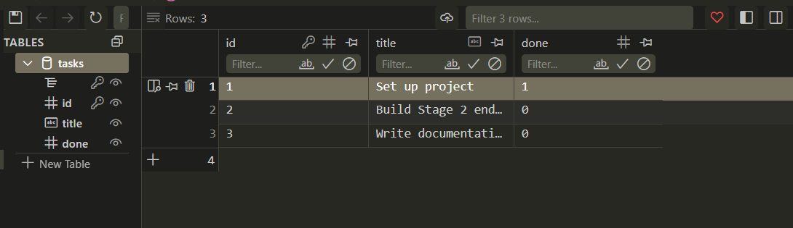

# Task CRUD API with SQLite Database Persistence

The database-backed sequel to Assignment 1. Replaces the temporary in-memory list with an embedded **SQLite** database (`tasks.db`). The public API contract, endpoints, status codes, and JSON responses remain identical, but all task data now permanently survives server restarts.

---

## 1. Why SQLite?

1. **Zero Configuration & Embedded**: SQLite requires no external server process, daemon, or complex credentials. Python includes `sqlite3` in the standard library.
2. **Single-File Storage**: The entire database lives in a single local file (`tasks.db`).
3. **True Persistence**: Unlike in-memory storage where state is erased upon process termination, SQLite writes transactions directly to disk, ensuring data persistence across server restarts.
4. **Clean Git Clones**: `tasks.db` is `.gitignore`d, ensuring every collaborator who clones the repo starts with an automatic, reproducible schema and seed.

---

## 2. Database Schema & Architecture

* **File Location**: `tasks.db` (created automatically in the project directory upon application startup).
* **Automatic Setup**: `init_db()` is invoked at startup. It creates the `tasks` table if it does not already exist:

```sql
CREATE TABLE IF NOT EXISTS tasks (
    id INTEGER PRIMARY KEY AUTOINCREMENT,
    title TEXT NOT NULL,
    done INTEGER NOT NULL DEFAULT 0
);
```

* **Idempotent Seeding**: Before inserting starter tasks, the application checks `SELECT COUNT(*) FROM tasks`. If and only if the count is `0`, three starter tasks are seeded. Subsequent server restarts detect existing records and do not duplicate them.

---

## 3. Quickstart — Run with One Command

### Installation
```bash
pip install fastapi uvicorn
```

### Start the Server
```bash
uvicorn main:app --reload
```
The server will start locally at **`http://localhost:8000`**, automatically initialize `tasks.db`, and seed the initial records.

---

## 4. API Endpoints

All queries utilize **parameterized SQL statements** (`?` placeholders) to prevent SQL injection vulnerabilities.

| Method | Endpoint | Description | SQL Query | Status Codes |
| :--- | :--- | :--- | :--- | :--- |
| `GET` | `/` | API metadata & discovery | None | `200 OK` |
| `GET` | `/health` | Server health check | None | `200 OK` |
| `GET` | `/tasks` | List all tasks | `SELECT id, title, done FROM tasks` | `200 OK` |
| `GET` | `/tasks/{id}` | Get single task | `SELECT id, title, done FROM tasks WHERE id = ?` | `200 OK`, `404 Not Found` |
| `POST` | `/tasks` | Create task | `INSERT INTO tasks (title, done) VALUES (?, 0)` | `201 Created`, `400 Bad Request` |
| `PUT` | `/tasks/{id}` | Update task | `UPDATE tasks SET title = ?, done = ? WHERE id = ?` | `200 OK`, `400 Bad Request`, `404 Not Found` |
| `DELETE` | `/tasks/{id}` | Delete task | `DELETE FROM tasks WHERE id = ?` | `204 No Content`, `404 Not Found` |

---

## 5. Stage 4: SQL Explorations

Direct queries were executed against `tasks.db` to inspect the underlying table:

### Example Query
```sql
SELECT * FROM tasks WHERE done = 1;
```

### Result & Explanation
```text
(1, 'Set up project', 1)
```
* **Explanation**: Returns only tasks where the `done` status is stored as `1` (SQLite represents booleans as integer flags `0` or `1`).

Additional hand-tested queries are documented in [`queries.sql`](./queries.sql).

---

## 6. Database Inspection (DB Browser for SQLite)

Open `tasks.db` inside **DB Browser for SQLite** to view the `tasks` table and rows visually:



*(To generate your screenshot: open `tasks.db` in [DB Browser for SQLite](https://sqlitebrowser.org/), navigate to the "Browse Data" tab, capture a screenshot, and save it as `connect-crud-to-db/db_browser.png`).*

---

## 7. Stage Verification Commands

### Stage 0: Create SQLite Database (Idempotent Seed)
```powershell
python -c "import sqlite3; conn = sqlite3.connect('tasks.db'); print(conn.cursor().execute('SELECT COUNT(*) FROM tasks').fetchone()[0])"
```

### Stage 1: Read Endpoints
```powershell
# List all tasks (200 OK)
curl.exe -i http://localhost:8000/tasks

# Read single task (200 OK)
curl.exe -i http://localhost:8000/tasks/1

# Read missing task (404 Not Found)
curl.exe -i http://localhost:8000/tasks/999
```

### Stage 2: Create with Database Persistence
```powershell
# Create task (201 Created)
curl.exe --% -i -X POST http://localhost:8000/tasks -H "Content-Type: application/json" -d "{\"title\":\"Buy groceries\"}"

# Stop and restart server, then verify persistence across reboots
curl.exe -i http://localhost:8000/tasks
```

### Stage 3: Full Update & Delete
```powershell
# Update task (200 OK)
curl.exe --% -i -X PUT http://localhost:8000/tasks/1 -H "Content-Type: application/json" -d "{\"done\":true}"

# Validation on empty body (400 Bad Request)
curl.exe --% -i -X PUT http://localhost:8000/tasks/1 -H "Content-Type: application/json" -d "{}"

# Delete task (204 No Content)
curl.exe -i -X DELETE http://localhost:8000/tasks/1

# Verify deletion (404 Not Found)
curl.exe -i http://localhost:8000/tasks/1
```
